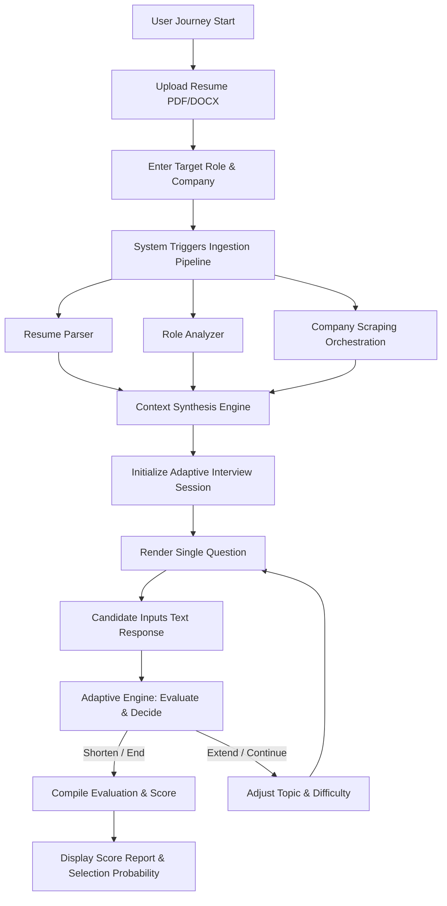

# HireFit AI: Adaptive Target-Company & Role-Specific Interview Simulator
## Comprehensive System Architecture, Design Specification, and Implementation Guide

**Document Version:** 1.0.0  
**Status:** Production / Master Technical Specification  
**Author:** Senior Technical Writer & Lead Systems Architect  
**Target Platform:** Fast-API (Python 3.12+), MongoDB, React 19 + Tailwind CSS v4 + shadcn/ui  
**Date:** September 2026  

---

### ABSTRACT

In contemporary technology and corporate recruitment landscape, candidates face an asymmetrical selection process characterized by company-specific evaluation cultures, high-density technical rubrics, and non-standardized behavioral metrics. Traditional interview preparation solutions suffer from generic static question banks, uncalibrated feedback loops, and lack of target-company operational context.

**HireFit AI** is an advanced, text-based adaptive interview simulation platform engineered to bridge this gap. By ingesting three core inputs—a candidate's resume (PDF/DOCX), a target job title and description, and a target company name—the platform dynamically executes a multi-phase preparation pipeline:
1. **Automated Resume Parsing & Skill Extraction:** Contextual extraction of technical proficiencies, project achievements, career trajectory, and skill gaps using custom Python parsers (`pdfplumber`, `python-docx`) combined with structured extraction heuristics.
2. **Role Profiling & Seniority Calibration:** Deep breakdown of target role responsibilities, required hard/soft skills, and seniority expectations (Junior, Mid, Senior, Lead/Principal) mapped to a dynamic taxonomy.
3. **Real-time Company Intelligence Ingestion:** Asynchronous web scraping engine (`httpx`, `BeautifulSoup4`, and selective `Playwright` rendering) gathering real-time organizational context, engineering blogs, core product architectures, cultural values, recent company news, and verified interview patterns.
4. **Adaptive Text-Only Interview Engine:** Stateful conversational agent that conducts a single-question-at-a-time text interview. The engine dynamically adjusts question difficulty, changes topic focus (technical depth, system design, architectural trade-offs, behavioral alignment, domain knowledge), and modifies session length (shortening upon clear mastery/failure or extending to resolve borderline competencies) while enforcing zero-hallucination and prompt-injection guardrails.
5. **Calibrated Evaluation & Probability Engine:** Multi-metric scoring framework providing a comprehensive score breakdown (Resume Fit, Answer Quality, Communication Clarity, Role Knowledge, Company Alignment) alongside a mathematically calibrated **Estimated Selection Probability ($P_{\text{selection}}$)**.

This document details the complete end-to-end architecture, mathematical rubrics, state machine definitions, database models, RESTful API contracts, frontend component design systems, security paradigms, testing frameworks, and deployment topologies for HireFit AI.

---

### TABLE OF CONTENTS

1. **Front Matter & Executive Summary**
2. **Introduction & Project Scope**
   - 2.1 Problem Statement & Industry Context
   - 2.2 Motivation & Core Objectives
   - 2.3 System Scope & Boundaries
   - 2.4 Target User Personas & User Journeys
3. **Market Survey & Gap Analysis**
   - 3.1 Review of Existing Interview Preparation Platforms
   - 3.2 Key Operational & Pedagogical Gaps
   - 3.3 HireFit AI Architectural Differentiation
4. **System Requirements & Constraint Specifications**
   - 4.1 Functional Requirements (FR-01 through FR-28)
   - 4.2 Non-Functional Requirements (NFR-01 through NFR-20)
   - 4.3 Technical & Architectural Constraints
   - 4.4 User Stories & Requirement Traceability Matrix
5. **System Architecture & Service Topology**
   - 5.1 High-Level Architecture & Layered Component Topology
   - 5.2 Python / FastAPI Micro-Service Modular Directory Design
   - 5.3 Data Flow Architecture & System Sequence Diagrams
   - 5.4 Architectural Rationale & Design Justifications
6. **Resume Analysis Module**
   - 6.1 Multi-Format Document Ingestion Engine (PDF / DOCX)
   - 6.2 Entity Extraction Pipeline & Section Segmentation
   - 6.3 Skill Taxonomy Mapping & Experience Chronology Parsing
   - 6.4 Resume Profiling Output Schema & Skill Gap Detection
7. **Role Analysis & Seniority Calibration Module**
   - 7.1 Job Description Parsing & Title Standardization
   - 7.2 Skill Taxonomy Matching & Expectation Weighting
   - 7.3 Seniority Matrix Calibration (Junior, Mid, Senior, Staff)
8. **Company Intelligence & Web Scraping Pipeline**
   - 8.1 Multi-Source Scraping Orchestrator Architecture
   - 8.2 DOM Extraction Heuristics & Dynamic Rendering Handlers
   - 8.3 In-Memory LRU & Redis Multi-Tier Caching Infrastructure
   - 8.4 Ethical Scraping, Robots.txt Compliance & Legal Guardrails
   - 8.5 Graceful Degradation & Fallback Synthetic Knowledge Engines
9. **Adaptive Text Interview Engine**
   - 9.1 Single-Question State Machine & Dialogue Control Flow
   - 9.2 Dynamic Difficulty Scaling & Topic Pivot Algorithms
   - 9.3 Adaptive Session Termination (Extend / Shorten Decision Tree)
   - 9.4 LLM Prompt Engineering & System Instructions Setup
   - 9.5 Anti-Hallucination & Prompt Injection Defense Mechanisms
10. **Scoring Model & Calibrated Selection Probability**
    - 10.1 Multi-Dimensional Evaluation Rubric
    - 10.2 Category Weighting & Score Normalization Algorithms
    - 10.3 Calibrated Selection Probability Function ($P_{\text{selection}}$)
    - 10.4 Actionable Feedback Generation & Gap Remediation Output
11. **Database Schema & Data Retention Architecture (MongoDB)**
    - 11.1 Document Collection Specifications & JSON Schemas
    - 11.2 Indexing Strategy for Low-Latency Query Execution
    - 11.3 Data Lifecycle, Privacy Scrubbing & Retention Policies
12. **API Design & Endpoint Contracts**
    - 12.1 FastAPI OpenAPI Endpoint Specifications
    - 12.2 Pydantic Request & Response Validation Schemas
    - 12.3 Session Authentication, State Hydration & Middleware Pipeline
13. **Frontend Architecture & UI Component Design**
    - 13.1 Component Architecture & Screen Flow Hierarchy
    - 13.2 Pure shadcn/ui Component Mapping & Screen Specifications
    - 13.3 Tailwind CSS v4 Setup & Minimal Aesthetic Guidelines
    - 13.4 Accessibility (WCAG 2.1 AA) & Responsive Design Enforcements
14. **Security, Privacy & Compliance Architecture**
    - 14.1 PII Scrubbing & Confidential Candidate Data Safeguards
    - 14.2 Encryption at Rest & In-Transit Controls
    - 14.3 Rate Limiting, Abuse Prevention & WAF Middleware
15. **Testing, Automated Evaluation & Quality Assurance**
    - 15.1 Backend Unit & Integration Test Suite (`pytest` / `httpx`)
    - 15.2 Frontend UI Component & End-to-End Test Suite
    - 15.3 LLM Output Reliability & Scoring Consistency Benchmark
16. **DevOps, Deployment & Infrastructure Cost Engineering**
    - 16.1 Containerization, CI/CD Pipeline & Deployment Topologies
    - 16.2 Infrastructure Cost Analysis & Capacity Planning
    - 16.3 Observability, Structured Logging & System Metrics Monitoring
17. **Ethical Considerations & Algorithmic Bias Mitigation**
    - 17.1 Analysis of Potential Bias in LLM-driven Interview Evaluation
    - 17.2 Mitigation Strategies & Auditing Frameworks
18. **Product Roadmap & Future Architectural Enhancements**
    - 18.1 Phase-Wise Feature Expansion & Scale Plan
19. **Appendices & Reference Specifications**
    - Appendix A: Production LLM Prompt Templates & Guardrails
    - Appendix B: Sample End-to-End Text Interview Transcript
    - Appendix C: Sample Comprehensive Evaluation Report JSON

---

## 2. INTRODUCTION & PROJECT SCOPE

### 2.1 Problem Statement & Industry Context

The contemporary recruitment pipeline for technical and specialized corporate roles presents severe challenges for job seekers:

1. **Context Asymmetrical Evaluation:** Hiring processes differ radically across organizations. A candidate applying for a Senior Software Engineer position at a high-growth fintech startup is evaluated on high-throughput microservices, latency optimization, and domain compliance. The same title at an enterprise cloud vendor emphasizes distributed consensus algorithms, multi-tenant security, and cross-functional leadership. Generic interview prep fails to reflect company specific context.
2. **Lack of Dynamic Feedback:** Standard practice platforms rely on static question-and-answer databases. Candidates memorize boilerplate solutions without experiencing the adaptive probing characteristic of live technical interviews—where interviewers drill down into edge cases, question architectural assumptions, or alter difficulty dynamically based on candidate responses.
3. **Ineffective Scoring & Blind Spots:** Post-interview feedback in traditional settings is either nonexistent or limited to binary pass/fail notices. Candidates remain unaware of whether their failure stemmed from resume-role misalignment, superficial technical depth, poor communication structure (e.g., failure to use STAR/CAR frameworks), or lack of target-company alignment.

### 2.2 Motivation & Core Objectives

**HireFit AI** was created to democratize personalized, high-fidelity interview coaching by delivering an automated, end-to-end simulation environment tailored precisely to the candidate's target job description and company profile.

#### Primary Objectives:
- **Zero-Bait Personalization:** Automatically ingest and parse candidate resumes alongside live scraped data from the target company to generate contextually relevant interview prompts.
- **Adaptive Real-Time Dialogue:** Implement a text-only, single-question conversational agent that adjusts query difficulty, branches topics based on prior answers, and dynamically alters interview length.
- **Calibrated Multi-Dimensional Evaluation:** Deliver a comprehensive post-interview feedback report featuring an empirical score, category breakdowns, actionable remediation steps, and a mathematically grounded **Estimated Selection Probability**.
- **Privacy-First & Performant Architecture:** Maintain strict candidate PII protection, sub-second API response times for non-LLM paths, and minimal client-side overhead using a streamlined React + Tailwind v4 + shadcn/ui frontend stack.

### 2.3 System Scope & Boundaries

#### In Scope:
- **Inputs:** Candidate resume upload (PDF/DOCX), target job title, job description text/link, and target company name.
- **Automated Scraping:** Asynchronous extraction of publicly available target company intelligence (tech stack, products, corporate values, recent press, tech blogs).
- **Mock Interview Execution:** Interactive, text-only chat interface operating strictly on a single active question flow.
- **Adaptive Control:** Engine logic capable of extending sessions (resolving ambiguity) or shortening sessions (rapid demonstration of mastery or severe failure).
- **Post-Interview Report:** Full report rendered with shadcn UI components, displaying sub-scores, qualitative analysis, and selection probability.

#### Out of Scope (Architectural Boundaries):
- Audio processing, real-time voice synthesis, speech-to-text, or webcam video analysis.
- Third-party hiring manager integration or direct ATS candidate submission.
- Automated code execution sandboxes (e.g., LeetCode-style code runners), prioritizing high-level system architecture, problem-solving prose, and conceptual depth.

### 2.4 Target User Personas & User Journeys

#### User Persona 1: Alex Rivera (Senior Backend Engineer)
- **Background:** 6 years of experience in Node.js and SQL; pivoting to a Staff Distributed Systems role at a tier-1 Cloud Infrastructure company.
- **Goal:** Needs deep, company-specific technical grilling on Go, distributed storage, and consensus protocols, tailored to the target company's published engineering blog stack.
- **Pain Point:** Generic prep platforms ask basic algorithm questions without testing real-world system architecture trade-offs.

#### User Persona 2: Priya Sharma (Product Manager)
- **Background:** Mid-level PM transitioning from B2C e-commerce to a B2B SaaS Enterprise platform.
- **Goal:** Wants to practice execution, product sense, and company-alignment questions derived from the target company's recent product launches and cultural values.
- **Pain Point:** Lack of structured evaluation on communication clarity and strategic alignment.
