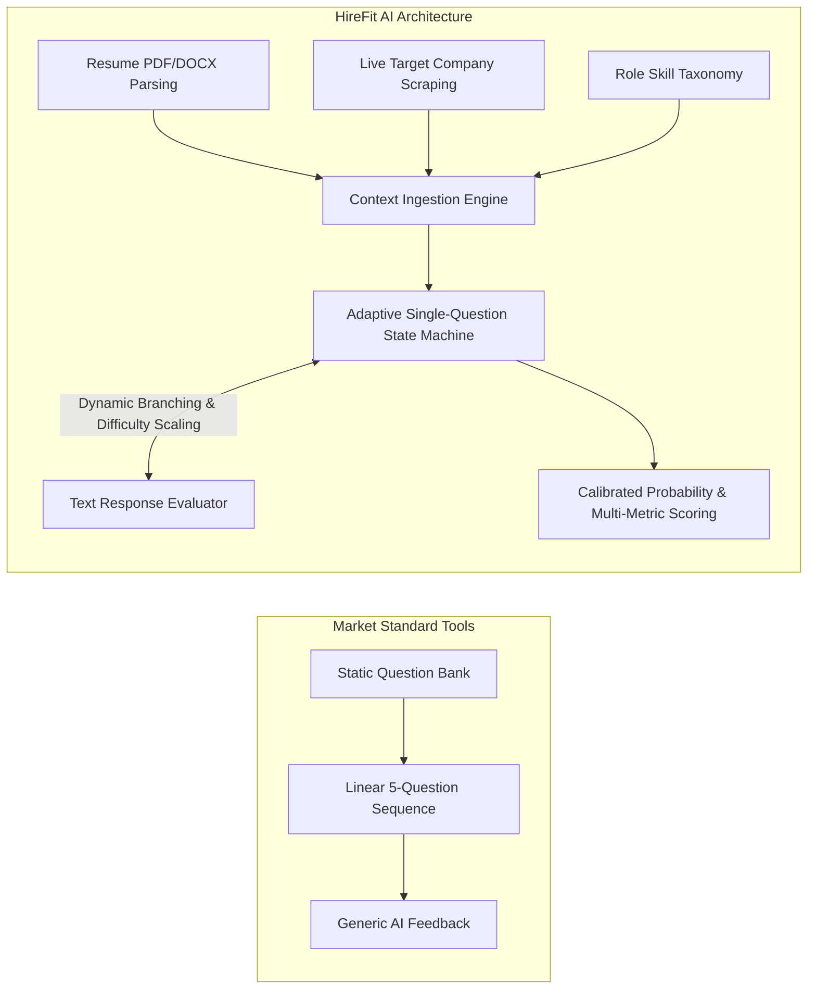

# HireFit AI: Section 3 & 4 - Market Survey & Requirements Specifications

---

## 3. MARKET SURVEY & EXISTING SOLUTIONS GAP ANALYSIS

### 3.1 Review of Existing Interview Preparation Platforms

The career technology landscape features several categories of interview preparation products, ranging from static question repositories to AI-assisted video platforms. Table 3.1 summarizes the leading solution categories:

| Solution Category | Key Products / Representatives | Core Features | Major Technical & Pedagogical Limitations |
| :--- | :--- | :--- | :--- |
| **Static Code & Algorithm Banks** | LeetCode, HackerRank, NeetCode | Automated unit-test grading, algorithm problem banks, language support. | Zero company operational context; focuses strictly on isolated DSA problems; no evaluation of system architecture, verbal rationale, or resume background fit. |
| **Generative AI Chat Bots (Generic)** | ChatGPT, Claude, Gemini (Vanilla UI) | Multi-turn text generation, general role Q&A prompts. | Requires manual candidate prompt engineering; lacks automated resume parsing, live company web scraping, structured state management, or calibrated scoring. |
| **AI Video / Avatar Simulators** | Interviewing.io (AI mode), Yoodli, Hinterview | Audio/Video transcription, speech cadence analysis, avatar animation. | High latency (>3-5s response delays); heavy client resource consumption; emphasis on superficial vocal cues rather than technical answer depth and company alignment. |
| **ATS / Resume Scanners** | Jobscan, Rezi, Resume Worded | Keyword matching between resume and static job description. | Passive analysis only; does not evaluate candidate performance under interactive follow-up questioning or test problem-solving depth. |

### 3.2 Key Operational & Pedagogical Gaps

Through analysis of current market tools, four structural gaps were identified:

1. **Context Blindness (The "Generic Question" Trap):** Existing LLM wrappers ask boilerplate questions (e.g., *"Tell me about a time you resolved a team conflict"*). They fail to synthesize candidate background ($R$) with specific target company tech stack and values ($C$) and role responsibilities ($J$).
2. **Static Dialogue Flow:** Standard interview simulators follow a fixed linear list of 5 or 10 questions regardless of candidate responses. If a candidate demonstrates immediate staff-level mastery on a topic, the system continues asking elementary questions. Conversely, if a candidate struggles with a core concept, it fails to probe deeper or adjust difficulty.
3. **Uncalibrated Feedback:** Feedback in current AI tools is frequently overly flattering ("Great job!") or generic. They lack a mathematically grounded, multi-metric scoring model anchored in real candidate fit and target role expectations.
4. **Heavy Visual Overhead:** Video/Avatar interview bots introduce significant latency, browser resource drain, and visual distractions without improving the fidelity of technical evaluation.

### 3.3 HireFit AI Architectural Differentiation

HireFit AI eliminates these deficiencies through a specialized, single-question text-based architecture:

---

## 4. SYSTEM REQUIREMENTS & CONSTRAINT SPECIFICATIONS

### 4.1 Functional Requirements

The system functional requirements are grouped into six core operational modules:

#### Module 1: Ingestion & Analysis (FR-01 to FR-05)
- **FR-01 [Resume Parsing]:** The system shall accept PDF and DOCX files up to 10MB and automatically parse contact info, technical skills, employment chronology, education, and project descriptions using `pdfplumber` and `python-docx`.
- **FR-02 [Role Ingestion]:** The system shall parse target job titles and raw job description text/URLs, extracting required skills, domain dependencies, and seniority levels (Junior, Mid, Senior, Lead).
- **FR-03 [Company Intelligence Scraping]:** The system shall asynchronously scrape target company web domains using `httpx` and `BeautifulSoup4` (falling back to `Playwright` for single-page JS apps) to extract tech stack, core products, corporate culture, and recent engineering news.
- **FR-04 [Scraping Compliance]:** The scraping engine shall parse and obey `robots.txt` rules, implement request throttling (max 2 req/sec per domain), and fall back to synthetic domain knowledge if scraping is blocked or times out (>5s).
- **FR-05 [Context Synthesis]:** The system shall compile parsed resume data, role specs, and scraped company intelligence into a unified JSON session context object within 3.0 seconds of ingestion completion.

#### Module 2: Interview Execution & State Management (FR-06 to FR-12)
- **FR-06 [Single-Question Enforcement]:** The interview engine shall present strictly ONE question at a time, blocking subsequent questions until the candidate submits a text response.
- **FR-07 [Adaptive Topic Selection]:** The engine shall dynamically select topics across five categories: Technical Depth, System Architecture, Behavioral Alignment, Company Alignment, and Problem-Solving Rationale.
- **FR-08 [Dynamic Difficulty Scaling]:** The engine shall increment question difficulty ($D \in \{1, 2, 3, 4, 5\}$) following high-scoring candidate answers ($\ge 80\%$) and decrement difficulty following poor answers ($\le 40\%$).
- **FR-09 [Adaptive Session Shortening]:** The engine shall automatically terminate the interview early (minimum 3 questions) if the candidate demonstrates consistent high-mastery or clear non-qualification across core competencies.
- **FR-10 [Adaptive Session Extension]:** The engine shall extend the interview length by up to 2 extra questions (maximum 10 questions total) if borderline scores ($45\% - 65\%$) require competency resolution.
- **FR-11 [Text-Only Interaction]:** The user interface shall provide a text-only input area supporting Markdown syntax, code block formatting, and keyboard shortcuts (`Cmd/Ctrl + Enter` to submit).
- **FR-12 [State Persistence]:** The system shall persist interview session state, question-answer pairs, timestamped turn logs, and difficulty state to MongoDB after every turn.

#### Module 3: Scoring & Evaluation (FR-13 to FR-18)
- **FR-13 [Multi-Metric Rubric]:** The scoring engine shall evaluate complete interviews across five dimensions: Resume-Role Fit (25%), Technical Answer Quality (35%), Communication Structure (15%), Seniority Calibration (15%), and Target Company Knowledge (10%).
- **FR-14 [Estimated Selection Probability]:** The engine shall compute a calibrated selection probability score $P_{\text{selection}} \in [0.00, 0.99]$ using a logistic sigmoid scaling function based on normalized rubric scores.
- **FR-15 [Disclaimer Enforcement]:** The UI shall explicitly display a prominent disclaimer stating that selection probability is an algorithmic estimate for prep purposes, not a hiring guarantee.
- **FR-16 [Qualitative Feedback]:** The report shall generate specific bullet points outlining candidate key strengths, identified technical gaps, and actionable remediation recommendations.
- **FR-17 [Transcript Generation]:** The system shall provide an interactive expandable transcript view showing every question asked, candidate answer, question topic, difficulty level, and turn score.
- **FR-18 [PDF Report Export]:** The frontend shall allow candidates to export their evaluation report as a clean PDF document.

### 4.2 Non-Functional Requirements (NFR)

- **NFR-01 [API Latency]:** Non-LLM REST API endpoints shall respond within $\le 200\text{ ms}$ (95th percentile). LLM question generation streaming/responses shall achieve First Chunk Latency $\le 1.2\text{ s}$.
- **NFR-02 [Concurrent Scale]:** The backend architecture shall support at least 100 concurrent active interview sessions without degraded response times on standard 2-vCPU / 4GB app nodes.
- **NFR-03 [Availability]:** System uptime shall meet $\ge 99.9\%$ operational availability, excluding scheduled maintenance.
- **NFR-04 [Data Privacy & PII]:** Candidate resumes and interview transcripts shall have PII (Phone numbers, SSNs, personal email addresses) automatically scrubbed prior to sending contexts to external LLM provider APIs.
- **NFR-05 [Data Retention]:** User session documents and transcripts in MongoDB shall be configured with Time-To-Live (TTL) indexes for automatic deletion after 30 days unless explicitly saved by the user.
- **NFR-06 [Security Compliance]:** All data in transit must enforce TLS 1.3 encryption. Data at rest in MongoDB must be encrypted using AES-256.
- **NFR-07 [Frontend Accessibility]:** The React client shall comply with WCAG 2.1 Level AA accessibility standards, supporting keyboard navigation, screen-reader ARIA attributes, and high contrast ratios.
- **NFR-08 [Mobile Responsiveness]:** The user interface shall render fluidly across mobile (375px+), tablet, and desktop viewports without layout breaking or horizontal scrollbars.

### 4.3 Requirement Traceability Matrix

| Requirement ID | Module | Priority | Target Architecture / Component | Verification Method |
| :--- | :--- | :--- | :--- | :--- |
| **FR-01** | Resume Ingestion | High | `backend/services/resume_parser.py` (`pdfplumber`) | Pytest unit test with sample PDFs |
| **FR-03** | Scraping Engine | High | `backend/services/scraper.py` (`httpx`, `BS4`, `Playwright`) | Integration test against mock domains |
| **FR-06** | Engine State | Critical | `backend/engine/state_machine.py` | State transition unit tests |
| **FR-09** | Engine Adaptive | Medium | `backend/engine/adaptation_rules.py` | Simulation tests across answer scores |
| **FR-14** | Scoring Model | Critical | `backend/services/scoring_engine.py` | Mathematical validation suite |
| **NFR-01** | Performance | High | FastAPI Async Handlers + Uvicorn | Locust load testing benchmark |
| **NFR-04** | Privacy | Critical | `backend/middleware/pii_scrubber.py` | Regex & NER privacy audit tests |

---
