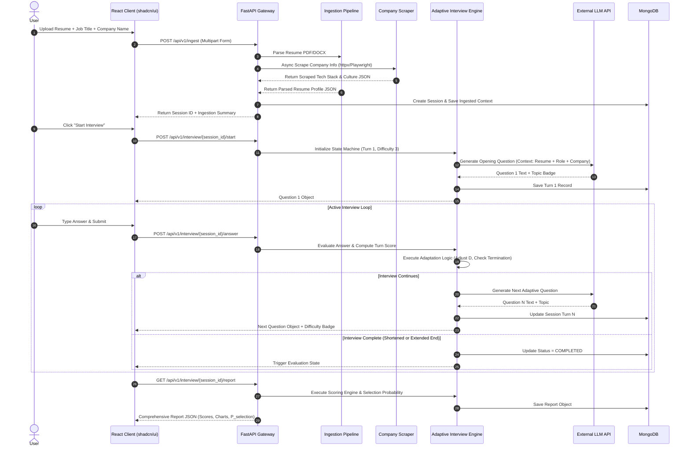

# HireFit AI: Section 5, 6 & 7 - Architecture, Resume Analysis & Role Profiling

---

## 5. SYSTEM ARCHITECTURE & SERVICE LAYOUT

### 5.1 High-Level Architecture & Layered Topology

HireFit AI implements an asynchronous, modular microservice architecture engineered for high concurrency, low latency, and modularity. The system comprises four architectural layers:

1. **Client Layer (Presentation):** SPA built with React 19, Tailwind CSS v4, and shadcn/ui components. State managed via React Context and TanStack Query.
2. **API & Gateway Layer:** FastAPI application serving REST endpoints, executing Pydantic data validation, rate-limiting middleware, CORS handling, and PII scrubbing.
3. **Core Processing Engine Layer:**
   - *Ingestion Pipeline:* Document Parser (`pdfplumber` / `python-docx`) + Scraping Orchestrator (`httpx` + `Playwright`).
   - *Interview State Engine:* Stateful dialogue control loop managing dynamic question generation, turn logs, and adaptation logic.
   - *Scoring & Analytics Engine:* Multi-metric evaluation rubric + mathematical probability calibration model.
4. **Data & Infrastructure Layer:** MongoDB Atlas / Local MongoDB instance for persistent documents (`Session`, `ResumeProfile`, `CompanyIntel`, `InterviewTurn`, `EvaluationReport`) and Redis / In-Memory LRU cache for scraped company data.

```mermaid
graph TD
    subgraph Client Layer (React 19 + Tailwind v4 + shadcn/ui)
        UI[Single Page App UI]
        State[TanStack Query State Hydrator]
    end

    subgraph API & Gateway Layer (FastAPI Async)
        Router[APIRouter /api/v1]
        MW[Middleware: Auth, CORS, RateLimit, PII Scrubber]
        Validation[Pydantic V2 Schemas]
    end

    subgraph Core Processing Engine Layer
        RPM[Resume Parser Module]
        RAM[Role Analysis Module]
        CIM[Company Intelligence Scraper]
        AIE[Adaptive Interview Engine]
        SEM[Scoring & Probability Engine]
    end

    subgraph Data & Storage Layer
        Mongo[(MongoDB Database)]
        Cache[(Redis / In-Memory LRU Cache)]
        LLM[External LLM API Provider]
    end

    UI <--> Router
    Router --> MW --> Validation
    Validation --> RPM & RAM & CIM & AIE & SEM
    CIM <--> Cache
    AIE <--> LLM
    SEM <--> LLM
    RPM & RAM & CIM & AIE & SEM <--> Mongo
```

### 5.2 Python / FastAPI Micro-Service Modular Directory Design

```
backend/
├── app/
│   ├── main.py                  # FastAPI initialization & lifespan events
│   ├── config.py                # Environment configurations (Pydantic Settings)
│   ├── api/
│   │   ├── v1/
│   │   │   ├── router.py        # Master API v1 route aggregator
│   │   │   ├── endpoints/
│   │   │   │   ├── ingestion.py # Upload & Scraping endpoints
│   │   │   │   ├── interview.py # Single-question chat loop endpoints
│   │   │   │   └── report.py    # Scoring & evaluation endpoints
│   ├── core/
│   │   ├── security.py          # PII scrubbing, CORS, API Key protection
│   │   ├── database.py          # Motor async MongoDB client setup
│   │   └── exceptions.py        # Global error handlers
│   ├── services/
│   │   ├── resume_parser.py     # PDF/DOCX parsing logic
│   │   ├── role_analyzer.py     # Skill taxonomy & seniority mapping
│   │   ├── company_scraper.py   # httpx + Playwright scraper logic
│   │   └── scoring_engine.py    # Rubric evaluation & probability math
│   ├── engine/
│   │   ├── state_machine.py     # Adaptive interview state machine
│   │   ├── adaptation.py        # Extend/Shorten/Difficulty rules
│   │   └── prompt_templates.py  # Zero-shot / Few-shot prompt contracts
│   └── models/
│       ├── domain.py            # Core Python dataclasses
│       └── schemas.py           # Pydantic V2 Request/Response models
├── tests/
│   ├── test_resume_parser.py
│   ├── test_scraper.py
│   ├── test_state_machine.py
│   └── test_scoring.py
├── requirements.txt
└── Dockerfile
```

### 5.3 Data Flow & System Sequence Diagram



---

## 6. RESUME ANALYSIS MODULE

### 6.1 Multi-Format Document Ingestion Engine

The resume parser processes binary PDF and DOCX uploads using Python native libraries without relying on expensive external commercial APIs.

#### PDF Processing Workflow (`pdfplumber`):
- Extract raw layout-preserved text page by page.
- Identify headers, bold font variations, and bullet points to delineate structural sections (Experience, Education, Projects, Skills).
- Sanitize control characters, null bytes, and non-printable Unicode artefacts.

#### DOCX Processing Workflow (`python-docx`):
- Traverse paragraph elements and nested XML table nodes.
- Extract bullet points, hyperlinked project URLs, and tabular skill matrices.

### 6.2 Entity Extraction Pipeline & Skill Gap Analysis

Once raw text is extracted, an extraction pipeline categorizes entities into structured fields:

```json
{
  "candidate_name": "Jane Doe",
  "total_experience_years": 6.5,
  "contact_info_scrubbed": {
    "email": "[REDACTED_EMAIL]",
    "phone": "[REDACTED_PHONE]"
  },
  "technical_skills": {
    "languages": ["Python", "TypeScript", "SQL", "Go"],
    "frameworks": ["FastAPI", "React", "Node.js", "Docker"],
    "cloud_databases": ["AWS ECS", "PostgreSQL", "MongoDB", "Redis"]
  },
  "work_chronology": [
    {
      "company": "Tech Corp",
      "role": "Senior Software Engineer",
      "duration_months": 36,
      "key_achievements": [
        "Architected async payment pipeline handling 50k RPM",
        "Reduced database query latency by 40% using Redis caching"
      ]
    }
  ],
  "detected_skill_gaps": [
    "No explicit Kubernetes cluster orchestration experience noted",
    "Limited exposure to gRPC microservice communication"
  ]
}
```

---

## 7. ROLE ANALYSIS & SENIORITY CALIBRATION MODULE

### 7.1 Job Description Parsing & Title Standardization

Target role input (job title + text description) undergoes normalization against an internal standardized skill taxonomy.

#### Seniority Level Mapping Rules:
- **Junior (Level 1):** $\le 2$ years experience; focus on core syntax, fundamental computer science concepts, and basic bug fixing.
- **Mid-Level (Level 2):** $2 - 5$ years experience; focus on feature ownership, API design, unit testing, and component integration.
- **Senior (Level 3):** $5 - 8$ years experience; focus on system design, trade-off analysis, performance optimization, and cross-team leadership.
- **Lead / Staff (Level 4+):** $8+$ years experience; focus on distributed architecture, multi-quarter technical roadmap planning, resilience engineering, and organizational impact.

### 7.2 Skill Matrix & Weighting Calibration

The system constructs a dynamic **Target Competency Matrix** by comparing parsed candidate skills against target role requirements:

$$\text{Competency Fit Ratio} = \frac{|\text{Skills}_{\text{Candidate}} \cap \text{Skills}_{\text{Role}}|}{|\text{Skills}_{\text{Role}}|}$$

$$\text{Weighted Skill Score} = \sum_{i=1}^{N} w_i \cdot \delta_i \quad \text{where } \delta_i = \begin{cases} 1.0 & \text{if Skill } i \text{ present in Resume} \\ 0.0 & \text{if Skill } i \text{ missing} \end{cases}$$

Where $w_i$ represents the relative priority weight ($0.1 \le w_i \le 1.0$) of skill $i$ in the target role profile.
